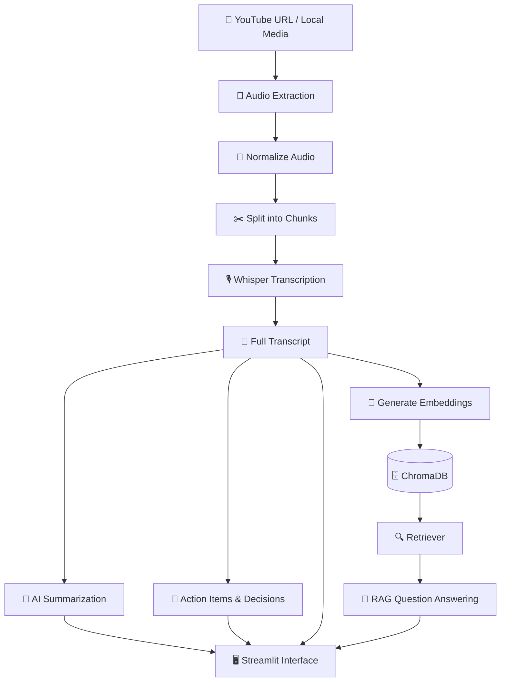
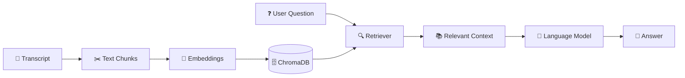

<div align="center">

# 🎬 AI Video Assistant 🤖

### Turn videos & meetings into searchable knowledge — powered by Generative AI.


<br/>


<br/><br/>

[🚀 Explore Repository](https://github.com/AkashRouth001/AI-Video-Assistant-main)
·
[🐛 Report a Bug](https://github.com/AkashRouth001/AI-Video-Assistant-main/issues)
·
[💡 Suggest an Idea](https://github.com/AkashRouth001/AI-Video-Assistant-main/issues)

</div>

---

## 🌟 Overview

🎯 **AI Video Assistant** is a Generative AI application that transforms YouTube videos and recorded meetings into searchable knowledge.

Instead of watching an entire recording again, you can generate transcripts, understand key points, extract action items, and ask questions about the content using **Retrieval-Augmented Generation (RAG)**.

Whether you're learning from technical tutorials, reviewing meetings, or analyzing webinars, this project helps turn long recordings into useful information.

### 🎯 Example Use Cases

- 🎓 Summarize educational YouTube videos and technical tutorials.
- 💼 Review recorded meetings without replaying the entire recording.
- 📌 Extract tasks, decisions, deadlines, and unanswered questions.
- 💬 Ask questions about a video or meeting transcript.
- 📚 Turn long recordings into searchable knowledge.
- 📄 Export generated notes and summaries where supported.

## ✨ Features

| Feature | Description |
|---|---|
| 🎥 Multiple Inputs | Process YouTube URLs and supported local audio/video files. |
| 🎙️ Audio Transcription | Transcribe audio using OpenAI Whisper locally. |
| 🌐 Hindi Transcription | Optional Sarvam AI integration for Hindi audio. |
| 🧠 AI Summarization | Generate concise summaries and key talking points using Mistral AI. |
| 📌 Action Items | Extract tasks, owners, and deadlines when mentioned. |
| ✅ Decision Extraction | Identify important decisions from the transcript. |
| ❓ Question Extraction | Identify unresolved questions and follow-ups. |
| 🔍 Semantic Search | Retrieve relevant transcript sections using embeddings. |
| 💬 Chat with Videos | Ask questions about the content using RAG. |
| 🗄️ Vector Database | Store transcript embeddings using ChromaDB. |
| 🖥️ Interactive UI | Use Streamlit to interact with the application. |
| 📄 Report Export | Export summaries to PDF or text where implemented. |

## ⚙️ How It Works



### 🔄 Processing Pipeline

1. 📥 **Input:** Provide a YouTube URL or a supported local media file.
2. 🎵 **Audio preparation:** Extract audio, convert it to mono 16 kHz WAV, and split long recordings into manageable chunks.
3. 🎙️ **Transcription:** Use Whisper locally to convert speech into text.
4. 🌐 **Language handling:** Optionally use Sarvam AI for Hindi transcription when configured.
5. 🧠 **Summarization:** Send transcript text to Mistral AI to generate summaries and key points.
6. 📌 **Information extraction:** Identify action items, decisions, and open questions.
7. 🔢 **Embedding generation:** Split the transcript into chunks and convert them into vector embeddings.
8. 🗄️ **Vector storage:** Store embeddings in ChromaDB for semantic retrieval.
9. 💬 **Question answering:** Retrieve relevant transcript chunks and use them as context for answers.
10. 🚀 **Results:** Review the transcript and generated insights in the Streamlit interface.

## 🧰 Technology Stack

| Component | Technology | Purpose |
|---|---|---|
| 💻 Programming Language | Python | Application logic |
| 🖥️ Frontend | Streamlit | Interactive web interface |
| 🎙️ Speech Recognition | OpenAI Whisper | Local audio transcription |
| 🌐 Optional Transcription | Sarvam AI | Hindi speech-to-text |
| 🧠 Large Language Model | Mistral AI | Summarization and Q&A |
| 🔗 LLM Orchestration | LangChain / LCEL | Compose model and prompt pipelines |
| 🗄️ Vector Database | ChromaDB | Store and retrieve transcript chunks |
| 🔢 Embeddings | Hugging Face `all-MiniLM-L6-v2` | Semantic text representations |
| 📥 YouTube Processing | `yt-dlp` | Download audio from supported URLs |
| 🎵 Audio Processing | FFmpeg and pydub | Convert and split audio |
| 📄 PDF Generation | FPDF2 | Generate PDF reports where enabled |

## 🗂️ Project Structure

The following is the intended module layout. Adjust it if the actual repository uses different filenames or directories.

```text
AI-Video-Assistant-main/
├── app.py                    # Streamlit user interface
├── main.py                   # Pipeline orchestration
├── requirements.txt          # Python dependencies
├── .env                      # API keys (never commit this file)
├── core/
│   ├── transcriber.py        # Whisper transcription
│   ├── summarizer.py         # AI-generated summaries
│   ├── extractor.py          # Actions, decisions, questions
│   ├── vector_store.py       # Embeddings and ChromaDB
│   └── rag_engine.py         # RAG question answering
├── utils/
│   └── audio_processor.py    # Download, convert, split audio
├── downloads/                # Temporary audio files
└── vector_db/                 # Local vector database
```

## 🚀 Getting Started

Follow these steps to set up the project on your local machine.

### 📋 Prerequisites

Make sure you have:

- 🐍 Python installed in a version supported by the dependencies.
- 📦 `pip` or `uv` for dependency management.
- 🎵 FFmpeg installed and available on your system PATH.
- 🔑 A Mistral AI API key.
- 🌐 A Sarvam AI API key if you use the optional Sarvam transcription integration.
- 💾 Sufficient memory and storage for audio processing and Whisper models.

> 💡 Whisper downloads its model weights the first time it runs. Processing time depends on the model size and your hardware.

### 1️⃣ Clone the Repository

```bash
git clone https://github.com/AkashRouth001/AI-Video-Assistant-main.git
cd AI-Video-Assistant-main
```

### 2️⃣ Create a Virtual Environment

**Windows PowerShell**

```powershell
python -m venv .venv
.\.venv\Scripts\Activate.ps1
```

**macOS / Linux**

```bash
python -m venv .venv
source .venv/bin/activate
```

Alternatively, create the environment using `uv`:

```bash
uv venv
```

Activate it using the command for your operating system.

### 3️⃣ Install Dependencies

Using pip:

```bash
python -m pip install --upgrade pip
pip install -r requirements.txt
```

Or using uv:

```bash
uv pip install -r requirements.txt
```

### 4️⃣ Install FFmpeg

Install FFmpeg for your operating system and verify the installation:

```bash
ffmpeg -version
```

If audio conversion fails, check that FFmpeg is installed correctly and accessible from your terminal.

## 🔐 Configuration

Create a `.env` file in the project root and add your own API keys:

```env
MISTRAL_API_KEY=your_mistral_api_key
WHISPER_MODEL=small

# Optional: only needed for Sarvam AI transcription
SARVAM_API_KEY=your_sarvam_api_key
```

🔑 Get your API keys from:

- [Mistral AI Console](https://console.mistral.ai/)
- [Sarvam AI](https://www.sarvam.ai/) — optional

### 🔒 Security Best Practices

- Never upload `.env` or API keys to GitHub.
- Add `.env` to your `.gitignore` file.
- If an API key is accidentally exposed, revoke it and generate a replacement.
- Review the providers' current privacy policies before processing confidential recordings.

## ▶️ Run the Application

From the project root, run:

```bash
streamlit run app.py
```

Open the local URL displayed in your terminal.

You can then use the interface to provide a YouTube URL or upload supported media, select the available transcription options, and review the generated results.

> ⚠️ Check your repository's current code for exact input formats and available export features.

## 🧠 How RAG Works in This Project

**Retrieval-Augmented Generation (RAG)** allows the assistant to answer questions using relevant sections of a transcript rather than relying only on the language model's general knowledge.

### 🔍 RAG Workflow



### Step-by-step explanation

1. 📝 The transcript is divided into smaller text chunks.
2. 🔢 A Hugging Face embedding model converts each chunk into a vector.
3. 🗄️ ChromaDB stores the vectors and associated text.
4. 🔍 A retriever finds the most relevant chunks for the user's question.
5. 🧠 The language model receives the retrieved context and generates an answer.
6. 💬 The answer is returned to the user.

The RAG prompt is designed to keep answers grounded in the provided transcript and indicate when information cannot be found.

> 💡 AI-generated answers can still contain mistakes. Verify important information against the original recording.

## 🛡️ Privacy and Cost Considerations

- **🎙️ Local transcription:** Whisper runs locally when configured as described, reducing the need for hosted transcription APIs.
- **🧠 LLM processing:** Transcript text sent to Mistral AI is processed by that provider.
- **🌐 Optional transcription API:** Audio sent through Sarvam AI is processed by its service.
- **💰 Costs:** Local Whisper and local embeddings avoid hosted transcription and embedding charges. Mistral and Sarvam may have usage limits, quotas, or fees.
- **🔐 Confidentiality:** Obtain authorization before processing meeting recordings or other private material.

Free tiers and provider policies may change over time.

## 🧯 Troubleshooting

| Problem | Possible Solution |
|---|---|
| `ffmpeg` not found | Install FFmpeg and verify it using `ffmpeg -version`. |
| Missing API key | Check the `.env` file and variable names. |
| YouTube download fails | Verify the URL, network connection, and `yt-dlp` version. |
| Whisper is slow | Try a smaller model or shorter audio chunks. |
| Memory errors | Reduce model size and process recordings in chunks. |
| Sarvam API errors | Check the key, service status, and current request limits. |
| ChromaDB errors | Confirm dependencies are installed and the database directory is writable. |
| Audio conversion fails | Check FFmpeg installation and the input file format. |

## 🛣️ Future Improvements

Potential enhancements for future versions:

- [ ] ⏱️ Add timestamps and source references to generated answers.
- [ ] 👥 Add speaker identification and diarization.
- [ ] 📚 Support multiple recordings and searchable session history.
- [ ] 📌 Improve action-item ownership and deadline extraction.
- [ ] 🧪 Add automated tests for transcription, summarization, and retrieval.
- [ ] 🐳 Add Docker support.
- [ ] ☁️ Add deployment instructions.
- [ ] ⚡ Improve processing progress and error reporting.

## 🤝 Contributing

Ideas and improvements are welcome!

1. Fork the repository.
2. Create a feature branch.
3. Make your changes and test them.
4. Submit a pull request describing the improvement.

For bugs or suggestions, use the [GitHub Issues page](https://github.com/AkashRouth001/AI-Video-Assistant-main/issues).

## 📄 License

No license information was provided in the project details. Add a `LICENSE` file before distributing or authorizing reuse of the code.

Without an explicit license, others should not assume they have permission to reuse the project.

---

<div align="center">

### 💜 Built with curiosity, Python, and Generative AI

**Created by [Akash Routh](https://github.com/AkashRouth001)**

⭐ If you find this project useful, consider giving the repository a star!

[⬆️ Back to Top](#-ai-video-assistant-)

</div>
