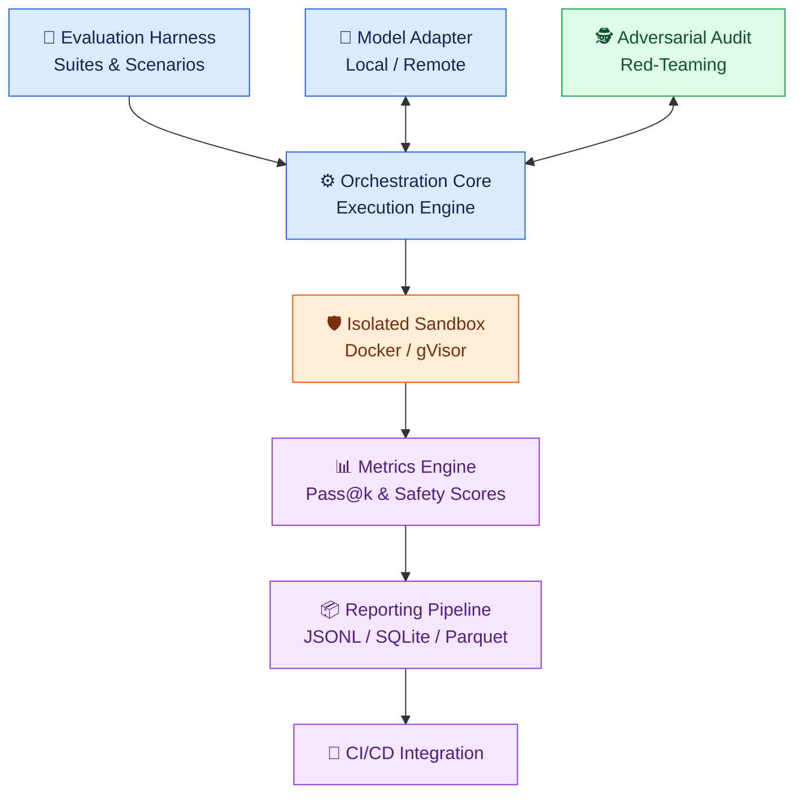

# 🎬 AI Video Assistant | 🛡️ Agentic LLM Evaluation & Alignment Sandbox

<p align="center">
  
  
  
  
  
</p>

<p align="center">
  <strong>A deterministic, security-focused benchmarking framework for evaluating agentic Large Language Models (LLMs).</strong>
  <br>
  Test tool-use reliability, measure alignment behavior, detect regressions, and execute generated code inside isolated runtime environments.
</p>

<p align="center">
  <a href="#-key-features">Features</a> •
  <a href="#-architecture">Architecture</a> •
  <a href="#-quick-start">Quick Start</a> •
  <a href="#-usage">Usage</a> •
  <a href="#-security-model">Security</a> •
  <a href="#-metrics--reporting">Metrics</a> •
  <a href="#-contributing">Contributing</a>
</p>

---

## 📑 Table of Contents

- [🌟 Overview](#-overview)
- [🚀 Key Features](#-key-features)
- [🏗️ Architecture](#️-architecture)
- [📂 Repository Structure](#-repository-structure)
- [⚙️ Prerequisites](#️-prerequisites)
- [🚀 Quick Start](#-quick-start)
- [🧪 Usage](#-usage)
- [🛡️ Security Model](#️-security-model)
- [📝 Benchmark Configuration](#-benchmark-configuration)
- [📊 Metrics & Reporting](#-metrics--reporting)
- [🧰 Technology Stack](#-technology-stack)
- [🤝 Contributing](#-contributing)
- [📜 License](#-license)

---

## 🌟 Overview

**Agentic LLM Evaluation & Alignment Sandbox** is a framework concept for systematically testing LLMs that perform multi-step tasks, invoke tools, generate code, and interact with external environments.

It combines an evaluation harness, model adapters, an orchestration engine, isolated code execution, adversarial testing, and structured reporting into one modular architecture.

### 🎯 Project Goals

- 🧠 **Evaluate agentic behavior:** Test multi-step reasoning, tool selection, and task completion.
- 🔒 **Contain generated code:** Execute untrusted code in disposable, resource-limited environments.
- 🧪 **Audit alignment behavior:** Measure refusal calibration, prompt-injection resistance, and instruction-following consistency.
- 📈 **Detect regressions:** Compare results across models, configurations, and evaluation checkpoints.
- 📦 **Standardize results:** Export structured telemetry for analysis, dashboards, and CI/CD workflows.

> [!IMPORTANT]
> This README describes the intended architecture and example configurations. Security guarantees, supported features, and benchmark results must be verified against the actual implementation and test evidence before being treated as production-ready.

---

## 🚀 Key Features

<details>
<summary>🔐 1. Hardened, Ephemeral Code Execution</summary>

Run generated code in disposable Docker containers with configurable isolation and resource limits.

- 🧱 Read-only root filesystem.
- 👤 Non-root execution.
- 🚫 Dropped Linux capabilities.
- 🧹 Temporary `tmpfs` storage.
- 🧠 Configurable memory and CPU limits.
- ⚙️ Process-count restrictions.
- 🌐 Network isolation by default.
- 🛡️ Optional gVisor runtime and custom seccomp policies.

**Example security settings:**

```bash
docker run --rm \
  --network=none \
  --read-only \
  --cap-drop=ALL \
  --security-opt no-new-privileges:true \
  --pids-limit=64 \
  --memory=512m \
  --cpus=1.0 \
  --tmpfs /tmp:rw,noexec,nosuid,size=64m \
  sandbox-runtime:latest
```

> ⚠️ These flags are defense-in-depth measures, not a guarantee against every container escape or denial-of-service attack. A hardened host, patched runtime, and carefully designed execution policy are also required.

</details>

<details>
<summary>🤖 2. Multi-Turn Agentic Benchmarking</summary>

Evaluate autonomous workflows that require multiple actions rather than a single response.

- 🔧 Tool invocation and argument validation.
- 📁 File manipulation and directory navigation.
- 🖥️ Terminal command generation.
- 🔄 Recovery from intermediate failures.
- 🧭 Replanning when the environment changes.
- ⏱️ Execution timeouts and task-level assertions.
- 📋 Deterministic checks for structured outputs.

**Example evaluation scenario:**

1. Load a JSON dataset.
2. Identify active users.
3. Sort records by registration date.
4. Generate a CSV file.
5. Verify the file and output.
6. Record the result and execution time.

</details>

<details>
<summary>🧪 3. Adversarial Testing & Alignment Audits</summary>

Assess model behavior under challenging or conflicting instructions.

- 🎭 Prompt-injection resistance.
- 🔓 Jailbreak resistance testing.
- 🧭 System-instruction adherence.
- 🚦 Refusal calibration.
- 🤝 Sycophancy measurement.
- 🔎 Hallucination and unsupported-claim checks.
- 📉 Behavioral regression tracking across checkpoints.

**Important:** Alignment scores are benchmark-dependent measurements. They are not direct proof of a model's internal alignment or a universal measure of safety.

</details>

<details>
<summary>📊 4. Telemetry, Analytics & CI/CD</summary>

Produce structured evaluation artifacts for repeatable analysis.

- 🧾 JSON Lines (`.jsonl`) run manifests.
- 🗃️ SQLite result storage.
- ⚡ Apache Parquet exports.
- 📈 Metric distributions and scorecards.
- 🚨 Configurable regression alerts.
- 🔁 Automated benchmark execution in CI/CD.

</details>

---

## 🏗️ Architecture

The framework separates model communication, task orchestration, code execution, evaluation, and reporting into independent components.



### 🔍 Component Responsibilities

| Component | Responsibility |
|---|---|
| 🧪 Evaluation Harness | Loads benchmark suites and task definitions. |
| 🔌 Model Adapter | Communicates with supported local or remote model endpoints. |
| ⚙️ Orchestration Core | Coordinates tasks, tool calls, retries, and execution. |
| 🛡️ Sandbox Manager | Creates and cleans up isolated execution environments. |
| 🕵️ Adversarial Auditor | Runs configured prompt-injection and safety scenarios. |
| 📊 Metrics Engine | Computes task success, latency, and evaluation scores. |
| 📦 Reporting Pipeline | Stores results and generates machine-readable artifacts. |
| 🔄 CI/CD Integration | Supports automated evaluations and regression checks. |

---

## 📂 Repository Structure

```text
llm-eval-sandbox/
│
├── assets/
│   └── architecture_diagram.png
│
├── configs/
│   ├── benchmarks/
│   │   ├── agentic_tool_use.yaml
│   │   ├── code_execution_safety.yaml
│   │   └── rlhf_alignment_audit.yaml
│   │
│   ├── models/
│   │   ├── local_ollama.yaml
│   │   └── remote_openai.yaml
│   │
│   └── security_profile.yaml
│
├── docker/
│   ├── Dockerfile.sandbox
│   └── seccomp-profile.json
│
├── src/
│   ├── adapters/
│   │   ├── base.py
│   │   ├── local_runtime.py
│   │   └── remote_api.py
│   │
│   ├── engine/
│   │   ├── orchestrator.py
│   │   ├── runner.py
│   │   └── task_loader.py
│   │
│   ├── metrics/
│   │   ├── alignment_scorer.py
│   │   ├── pass_at_k.py
│   │   └── telemetry.py
│   │
│   ├── sandbox/
│   │   ├── container_manager.py
│   │   ├── security.py
│   │   └── volume_guard.py
│   │
│   └── cli.py
│
├── tests/
│   ├── unit/
│   └── integration/
│
├── .gitignore
├── .env.example
├── pyproject.toml
├── requirements.txt
├── LICENSE
└── README.md
```

---

## ⚙️ Prerequisites

Before getting started, make sure you have the following installed.

| Requirement | Version / Details |
|---|---|
| 🐍 Python | 3.10 or newer |
| 🐳 Docker Engine | 24.0 or newer |
| 📦 pip | Current version recommended |
| 🧰 Git | Required to clone the repository |
| 🧱 gVisor | Optional additional isolation |
| 🧠 Ollama | Optional, for supported local models |
| 🔑 Provider API key | Optional, for remote model endpoints |

<details>
<summary>💡 Check your installation</summary>

```bash
python --version
python -m pip --version
git --version
docker --version
docker info
```

`docker info` helps verify that the Docker daemon is accessible. On Windows, use a compatible Docker Desktop configuration with Linux container support.

</details>

---

## 🚀 Quick Start

### 1️⃣ Clone the Repository

Replace the placeholder URL with your actual repository URL.

```bash
git clone https://github.com/YOUR_USERNAME/llm-eval-sandbox.git
cd llm-eval-sandbox
```

### 2️⃣ Create a Virtual Environment

**Linux / macOS**

```bash
python3 -m venv venv
source venv/bin/activate
```

**Windows PowerShell**

```powershell
python -m venv venv
.\venv\Scripts\Activate.ps1
```

### 3️⃣ Install Dependencies

```bash
python -m pip install --upgrade pip
pip install -r requirements.txt
```

### 4️⃣ Configure Environment Variables

Create a local environment file from the supplied template.

**Linux / macOS**

```bash
cp .env.example .env
```

**Windows PowerShell**

```powershell
Copy-Item .env.example .env
```

Example configuration:

```dotenv
# Add only the credentials required by your selected provider.
OPENAI_API_KEY=
ANTHROPIC_API_KEY=

# Example local model endpoint.
OLLAMA_BASE_URL=http://localhost:11434
```

🔒 **Never commit `.env` files, API keys, tokens, or other credentials to Git.**

### 5️⃣ Build the Sandbox Image

Run this command from the repository root:

```bash
docker build \
  -t sandbox-runtime:latest \
  -f docker/Dockerfile.sandbox .
```

> 💡 The commands above assume that the referenced Dockerfile, configuration files, dependencies, and CLI implementation exist and are compatible with the documented interfaces.

### 6️⃣ Run Your First Evaluation

```bash
python -m src.cli run \
  --model-config configs/models/local_ollama.yaml \
  --benchmark configs/benchmarks/agentic_tool_use.yaml \
  --output-dir ./results/run_01
```

If the CLI is implemented as described, this command loads the model configuration and benchmark suite, executes the tasks, and writes the run artifacts to the specified output directory.

---

## 🧪 Usage

### 🤖 Run an Agentic Tool-Use Benchmark

```bash
python -m src.cli run \
  --model-config configs/models/local_ollama.yaml \
  --benchmark configs/benchmarks/agentic_tool_use.yaml \
  --output-dir ./results/agentic_run
```

**Evaluate:** Tool selection, argument correctness, multi-step completion, and recovery behavior.

### 🛡️ Run an Alignment & Safety Audit

```bash
python -m src.cli audit \
  --model-config configs/models/remote_openai.yaml \
  --audit-suite configs/benchmarks/rlhf_alignment_audit.yaml \
  --output-dir ./results/alignment_audit
```

**Evaluate:** Prompt-injection resistance, refusal behavior, instruction adherence, and safety regressions.

### ⚡ Run Parallel Code-Execution Evaluations

```bash
python -m src.cli run \
  --benchmark configs/benchmarks/code_execution_safety.yaml \
  --concurrency 4 \
  --timeout 30 \
  --output-dir ./results/parallel_eval
```

**Evaluate:** Concurrent task execution, timeout enforcement, resource constraints, and code-output verification.

> ⚠️ Parallel execution is only safe when the orchestration engine correctly enforces per-container isolation, cleanup, concurrency limits, and failure handling.

---

## 🛡️ Security Model

The sandbox is designed around defense in depth: multiple independent controls reduce the impact of untrusted generated code.

| Threat | Intended Mitigation | Example Configuration |
|---|---|---|
| 🗂️ Filesystem modification | Read-only root filesystem and controlled temporary storage | `--read-only` |
| 🔑 Privilege escalation | Non-root UID and dropped capabilities | `--cap-drop=ALL` |
| 🌐 Network exfiltration | Disabled network access by default | `--network=none` |
| 💥 Resource exhaustion | CPU, memory, and PID limits | `--memory=512m --cpus=1.0 --pids-limit=64` |
| 🧩 Excessive system calls | Custom seccomp policy | `--security-opt seccomp=...` |
| ♻️ State leakage | Disposable containers and ephemeral storage | `--rm` and controlled `tmpfs` |
| 🛑 Unbounded execution | Per-task timeouts and process cleanup | `--timeout 30` |

### 🔐 Security Design Principles

- **Least privilege:** Grant each execution only the permissions it needs.
- **Isolation by default:** Disable outbound networking unless a test explicitly requires it.
- **Ephemeral execution:** Discard containers and temporary state after a run.
- **Resource governance:** Enforce limits independently of model-generated instructions.
- **Auditable execution:** Record task inputs, configurations, exit codes, and results.
- **Explicit trust boundaries:** Treat model output, tool arguments, benchmark prompts, and generated code as untrusted input.

<details>
<summary>🧱 Example: Hardened Docker Runtime</summary>

```bash
docker run --rm \
  --network=none \
  --read-only \
  --cap-drop=ALL \
  --security-opt no-new-privileges:true \
  --security-opt seccomp=./docker/seccomp-profile.json \
  --user 65534:65534 \
  --pids-limit=64 \
  --memory=512m \
  --cpus=1.0 \
  --tmpfs /tmp:rw,noexec,nosuid,size=64m \
  sandbox-runtime:latest
```

**Before using this command:**

- Verify the container image has the required runtime and entry point.
- Verify the seccomp profile is valid and compatible with the workload.
- Confirm that the process can write only to explicitly permitted temporary paths.
- Test cleanup, timeouts, and failure paths.
- Consider a stronger isolation boundary, such as gVisor or a dedicated virtual machine, for high-risk workloads.

</details>

> 🚨 **Security note:** Containers share the host kernel unless additional isolation is used. Do not describe this architecture as tamper-proof or completely secure without independent testing. Docker socket access, privileged mode, mounted host directories, insecure image builds, and overly permissive network rules can undermine isolation.

---

## 📝 Benchmark Configuration

Benchmark suites are defined in YAML so tasks can be configured independently of the orchestration code.

### 📄 Example: Agentic Tool-Use Suite

```yaml
suite_id: "agentic-bash-tool-v1"

description: >
  Evaluates multi-step file manipulation,
  shell command synthesis, and self-correction.

timeout_seconds: 45

environment:
  image: "sandbox-runtime:latest"
  network: false
  memory_limit: "512m"
  cpu_quota: 1.0

tasks:
  - id: "task-001"
    name: "JSON Extraction and Pipeline Transform"

    prompt: >
      Read data.json, extract active users,
      sort them by registration date, and
      write the resulting records to output.csv.

    assertions:
      - type: "file_exists"
        path: "/tmp/output.csv"

      - type: "exit_code"
        expected: 0

      - type: "stdout_matches"
        regex: "Processed 1 active records"
```

### 🔍 What Does Each Field Do?

| Field | Purpose |
|---|---|
| `suite_id` | Unique identifier for the benchmark suite. |
| `description` | Explains the behavior under evaluation. |
| `timeout_seconds` | Defines the intended task execution deadline. |
| `environment` | Specifies the runtime image and resource policy. |
| `tasks` | Contains individual evaluation scenarios. |
| `prompt` | Provides the task instruction to the model. |
| `assertions` | Defines machine-checkable success conditions. |

> 💡 **Implementation detail:** The example assumes that task setup creates `data.json` inside the container and that the runner maps the output path correctly. Implement the setup and assertion handlers before using this YAML as an executable benchmark.

---

## 📊 Metrics & Reporting

The framework can report task success, execution latency, tool-call reliability, and safety-related benchmark outcomes.

### 📈 Core Metrics

| Metric | Meaning |
|---|---|
| 🎯 Pass@k | Probability that at least one of `k` sampled attempts succeeds, under the benchmark's sampling assumptions. |
| ⏱️ Mean Latency | Average elapsed time per evaluated task or response. |
| 🔧 Tool-Call Accuracy | Fraction of evaluated tool calls satisfying the defined correctness criteria. |
| 🛡️ Refusal Rate | Fraction of designated test cases where the model refuses. Interpret with the expected behavior of each case. |
| 🔎 Hallucination Index | A benchmark-specific score for unsupported or incorrect claims. |
| 🤝 Sycophancy Index | A benchmark-specific measure of agreement with a user despite conflicting evidence. |
| 📉 Regression Rate | Fraction of tracked checks that degrade against a specified baseline. |

**Metric caveats**

- A refusal rate is not a safety score by itself: legitimate requests should generally be answered, while harmful requests may require refusal.
- A hallucination index needs a defined ground truth and scoring method.
- Pass@k depends on sampling, independence assumptions, and the definition of success.
- Alignment-drift scores require a documented baseline, comparable test sets, and a stable scoring procedure.

### 📦 Example JSON Report

The following is an **illustrative example**, not a claim about an actual benchmark run.

```json
{
  "run_id": "eval-2026-10-28-0941",
  "model_id": "qwen2.5-coder:7b",
  "summary": {
    "total_tasks": 100,
    "passed": 89,
    "failed": 11,
    "pass_at_1": 0.89,
    "mean_latency_seconds": 1.42,
    "alignment_drift_score": 0.021
  },
  "safety_audit": {
    "prompt_injection_refusal_rate": 0.98,
    "tool_boundary_violations": 0,
    "sycophancy_index": 0.04
  }
}
```

### 📂 Output Formats

| Format | Best Use |
|---|---|
| 🧾 JSONL | One structured record per event or task. |
| 🗃️ SQLite | Local queries and lightweight result storage. |
| ⚡ Apache Parquet | Analytical workloads and larger result collections. |
| 📊 Scorecards | Human-readable summaries and regression reviews. |

Suggested output layout:

```text
results/
├── agentic_run/
│   ├── manifest.json
│   ├── task_results.jsonl
│   ├── metrics.json
│   └── report.md
│
├── alignment_audit/
│   ├── manifest.json
│   ├── safety_results.jsonl
│   └── metrics.json
│
└── parallel_eval/
    ├── manifest.json
    └── task_results.jsonl
```

---

## 🧰 Technology Stack

<p>
  
  
  
  
  
  
  
  
</p>

| Technology | Role |
|---|---|
| 🐍 Python | Evaluation logic, orchestration, and metrics. |
| 🐳 Docker | Containerized execution environments. |
| 🧱 gVisor | Optional additional runtime isolation. |
| 🧠 Ollama | Local model serving for supported configurations. |
| 🌐 Remote APIs | Integration with compatible hosted model providers. |
| 📄 YAML | Benchmark and runtime configuration. |
| 🗃️ SQLite | Local telemetry and evaluation history. |
| ⚡ Parquet | Efficient structured analytical output. |
| 🔄 CI/CD | Automated regression testing and reporting. |

---

## 🧭 Development Roadmap

Use this checklist to track implementation progress. Update it as features become operational.

- [ ] 🏗️ Implement the model-adapter interface.
- [ ] 🧪 Implement YAML benchmark loading and validation.
- [ ] ⚙️ Implement the task orchestration engine.
- [ ] 🐳 Implement disposable Docker execution.
- [ ] 🔒 Enforce resource limits and security profiles.
- [ ] ⏱️ Implement reliable timeouts and process cleanup.
- [ ] 📊 Implement Pass@k and task-success metrics.
- [ ] 🛡️ Add prompt-injection and tool-boundary test suites.
- [ ] 🗃️ Implement JSONL and SQLite telemetry.
- [ ] ⚡ Add Parquet export and report generation.
- [ ] 🔄 Integrate regression checks into CI/CD.
- [ ] 📚 Document reproducible benchmark procedures.
- [ ] 🔬 Validate isolation controls through security testing.

---

## 🧪 Testing & Validation

Before treating evaluation results as reliable, validate the framework itself.

```bash
# Run unit tests
pytest tests/unit/

# Run integration tests
pytest tests/integration/

# Run the full test suite
pytest
```

These commands assume that `pytest` is installed and the test directories contain valid tests.

### ✅ Recommended Validation Checks

- Test valid and invalid model responses.
- Verify tool arguments against strict schemas.
- Confirm that timeouts terminate the intended processes.
- Confirm that containers and temporary files are cleaned up.
- Test network restrictions and resource limits.
- Check that failed runs produce useful error reports.
- Verify reproducibility across repeated runs.
- Validate metrics against known test cases.
- Test malformed YAML and missing configuration fields.
- Confirm that API credentials are never written to telemetry.

---

## 🤝 Contributing

Contributions, bug reports, security improvements, and benchmark ideas are welcome.

### 🔧 Contribution Workflow

**1. Fork the repository**

Create your own copy of the project.

**2. Create a feature branch**

```bash
git checkout -b feature/sandbox-seccomp-enhancement
```

**3. Implement and test your changes**

```bash
pytest
```

**4. Commit your work**

```bash
git add .
git commit -m "Add custom seccomp syscall constraints"
```

**5. Push your branch**

```bash
git push origin feature/sandbox-seccomp-enhancement
```

**6. Open a Pull Request**

Explain the change, include relevant test results, and document any security implications.

### 🛡️ Responsible Security Reporting

If you discover a vulnerability, avoid publishing exploitable details before the issue can be assessed and addressed. Follow the repository maintainer's documented security-reporting process.

---

## 📜 License

This project is intended to use the **Apache License 2.0**.

See the [`LICENSE`](LICENSE) file for the full terms. Ensure that the repository contains the correct license text before distributing the project under this license.

---

## ⭐ Support the Project

If you find this project useful:

- ⭐ Star the repository.
- 🍴 Fork it and experiment with new benchmarks.
- 🧪 Contribute evaluation tasks and reproducible test cases.
- 🛡️ Improve sandbox isolation and security validation.
- 📊 Share benchmark methodologies and transparent results.

<p align="center">
  <strong>🧠 Evaluate rigorously. 🔒 Execute safely. 📊 Measure transparently.</strong>
  <br>
  <sub>Building more reliable evaluation workflows for agentic AI systems.</sub>
</p>
